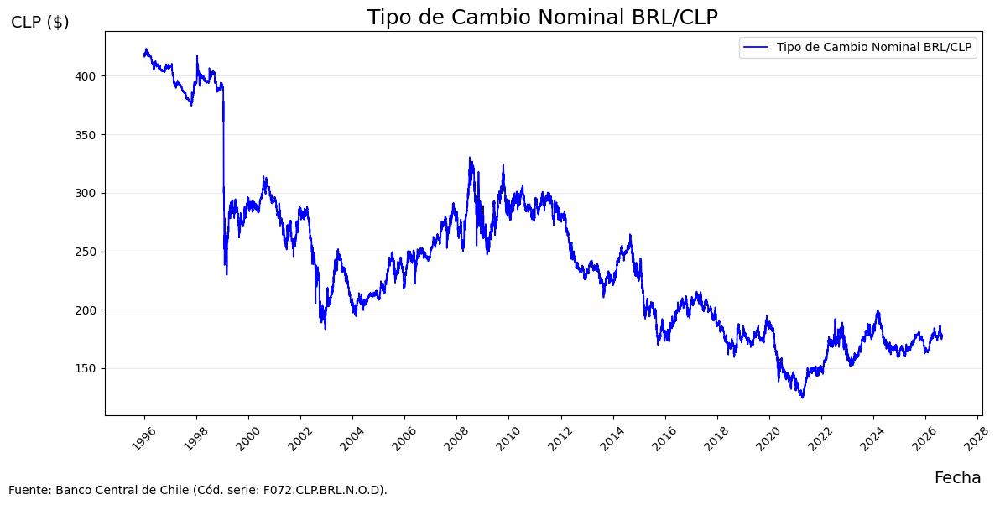

# Tipo de cambio nominal BRL/CLP (1996–2026), en Python

Exploración, limpieza y visualización de la serie diaria del tipo de cambio nominal del real brasileño en pesos chilenos: cuántos pesos cuesta un real. Los datos vienen del Banco Central de Chile (serie `F072.CLP.BRL.N.O.D`) y cubren 11.193 observaciones, desde enero de 1996 hasta agosto de 2026.

## Qué hice

- Exploré la estructura del dataset: dimensiones, tipos de datos y valores faltantes.
- Convertí las fechas a formato `datetime` y ordené la serie cronológicamente.
- Traté los valores faltantes (alrededor del 31% de la muestra, en su mayoría días sin cotización) con una media móvil de 7 observaciones.
- Construí un gráfico de la serie completa con matplotlib, con eje de años cada 2 años y la fuente citada.
- Interpreté la tendencia y los episodios de depreciación y apreciación.

## Resultados principales

- **Tendencia de largo plazo bajista:** el real pasó de cerca de $420 en 1996 a moverse entre $150 y $200 en la última década.
- **Caídas fuertes** en 1999 (devaluación del real, casi $200 menos por real), 2001–2002, 2008–2009, 2014–2016 y 2020–2021.
- **Recuperaciones** en 2002–2003 y 2009–2010.
- **Mínimo** en 2020, bajo los $150 por real.

## Cómo ejecutarlo

1. Descarga la serie `F072.CLP.BRL.N.O.D` de la Base de Datos Estadísticos del Banco Central de Chile y guárdala como `Real(in).csv`, con las columnas `Fecha` y `Valor`.
2. Abre `Yanez_Tomas_Reporte1.ipynb` en Jupyter o Google Colab y ejecuta todas las celdas.

**Herramientas:** Python · pandas · NumPy · matplotlib

---
Tomás Yáñez · Magíster en Economía Aplicada, Universidad del Desarrollo
